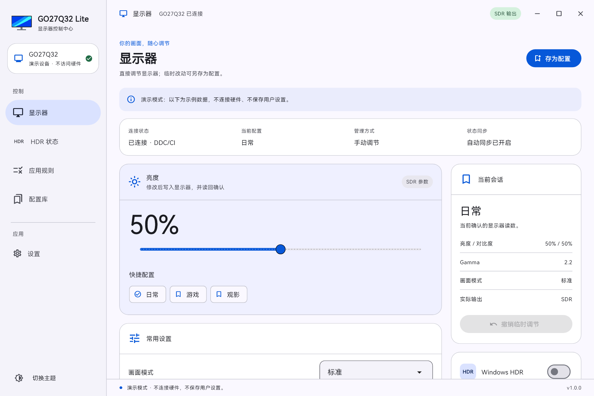
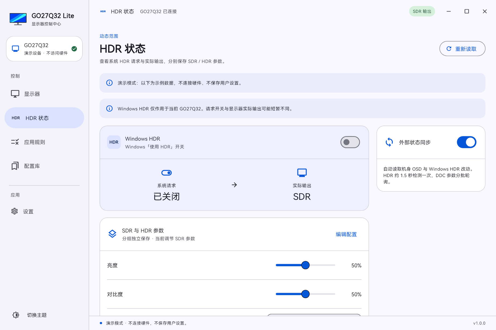
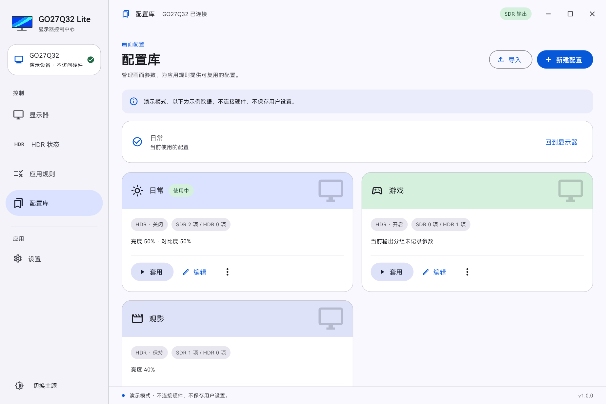
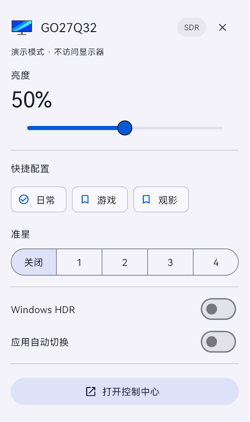

# GO27Q32 Lite

[简体中文](README.md) | [English](README.en.md)

A Windows control utility for the GIGABYTE GO27Q32 monitor. Adjust picture settings, save separate SDR/HDR profiles, and switch profiles when applications start or exit.

[Download for Windows](https://github.com/natsuz0ra/GO27Q32-Lite/releases/latest) · [Build instructions](docs/development.md)



## Install

Download `GO27Q32Lite-VERSION-windows-x64-setup.exe` from [Releases](https://github.com/natsuz0ra/GO27Q32-Lite/releases/latest). The installer offers Simplified Chinese and English, installs for the current user, and includes the .NET and Visual C++ runtimes. Administrator access is not required.

Windows 10/11 x64 is supported. Keep the monitor awake and enabled in Windows, with DDC/CI available. Chinese system languages default to Chinese; all other system languages default to English. Subsequent launches use your saved app language.

For a portable copy, extract `windows-x64.zip` and run `go27q32_lite.exe`. Keep its DLLs, `data` directory, and `backend` directory together.

## Features

- Brightness, contrast, SDR Picture Mode, Gamma, Color Temperature, Sharpness, Black eQualizer, Color Vibrance, Low Blue Light, Super Resolution, and Overdrive.
- Crosshair, refresh rate display, FreeSync, count-up/countdown timer, pause/resume, and six Game Assist positions.
- Windows HDR for the selected GO27Q32, with requested and actual output states shown separately.
- Profiles with separate SDR/HDR settings and a Keep/On/Off HDR policy; profile import and export.
- Application rules matched by full executable path, priorities, and desktop profile restoration.
- Input source, volume, OSD timeout/transparency, LED Indicator, and joystick shortcuts.
- Tray controls, startup settings, external OSD/HDR synchronization, light/dark/system themes, and Chinese/English UI.
- Manual GitHub release checks. An update is offered only when the remote stable version is greater than the installed version.

Sliders show your requested value immediately, then write and read back the monitor setting. Temporary adjustments do not overwrite saved profiles.

Single-click the tray icon for quick controls; double-click to open the main window. A single click waits for the system double-click detection interval. Right-click for Open, Pause Automatic Switching, and Exit.

## Screenshots

Screenshots use demo data. Both light and dark themes are available.

| HDR status | Profile library |
| --- | --- |
|  |  |



## Compatibility and limits

Writes are restricted to a uniquely identified GO27Q32 with hardware ID `GBT2761` or `GBT275C`. This release is for Windows x64. There is no macOS release or cross-device keyboard/mouse sharing.

Windows HDR control supports Windows 10 1709–22H2 and Windows 11 build 26100 or later. It remains disabled on earlier Windows 11 builds. Available picture controls in HDR depend on the monitor's reported capabilities.

The five HDR-specific picture presets must be selected using the monitor's physical OSD. Their software control protocol has not been established, so the app does not send guessed preset values.

Avoid letting GCC, OSD Sidekick, and this app automatically adjust the same monitor at the same time. Release binaries are unsigned; Windows may show an unknown-publisher prompt.

## Data and updates

Settings are stored at `%LOCALAPPDATA%\GO27Q32Lite\settings.json`, with a `.bak` backup. If the new location has no settings, the first load validates and copies settings from the legacy `GO27Q32LiteFlutter` directory, keeping the original files. Existing settings at the new location are never overwritten. Uninstallation preserves settings. Export your configuration before moving to another computer.

Update checks run only when requested in Settings. They query this repository's public GitHub Release API, without sending monitor details, profiles, or process lists. Updates are not downloaded or installed automatically. Versions use SemVer precedence; build metadata is ignored, and equal or older releases never trigger an update notice.

## Build

Requirements: Flutter 3.35.4 / Dart 3.9.2, Visual Studio 2022 Desktop development with C++, .NET 9 SDK, Python 3, and PowerShell 7.

```powershell
flutter pub get
./build.ps1 -Flutter (Get-Command flutter).Source -Dotnet (Get-Command dotnet).Source
./installer/build-installer.ps1 -Iscc 'C:\Program Files (x86)\Inno Setup 6\ISCC.exe'
```

Checks use simulated monitors. See [docs/development.md](docs/development.md) for the build and release workflow.

## License

Source code: [MIT](LICENSE). HarmonyOS Sans fonts have a separate [license](assets/fonts/LICENSE.txt). See [THIRD_PARTY_NOTICES.md](THIRD_PARTY_NOTICES.md) for dependencies and bundled runtimes.

An independent project, not affiliated with GIGABYTE. No GCC/OSD Sidekick binaries, firmware, or manufacturer installers are distributed.
